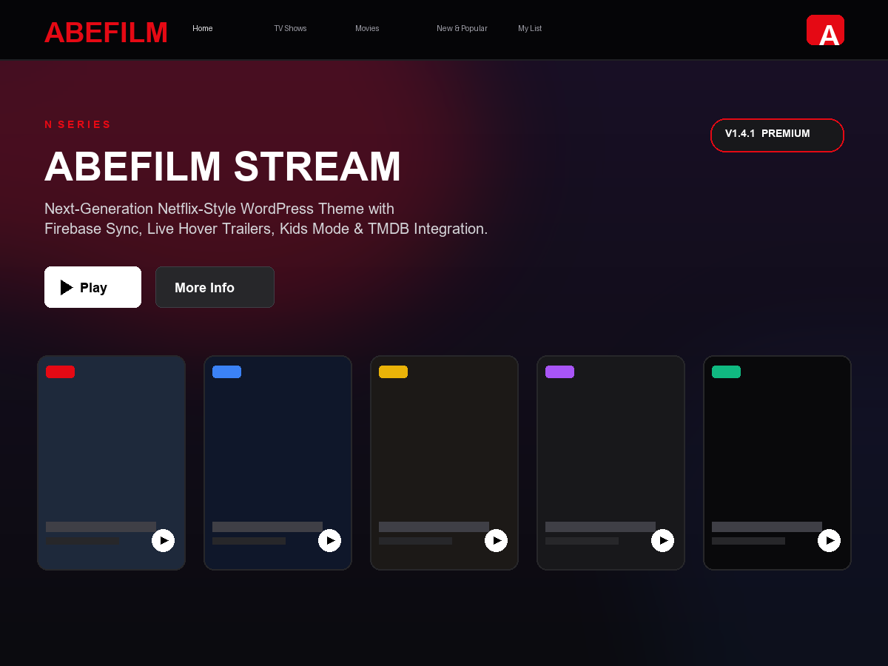
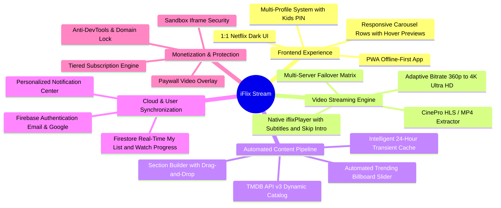
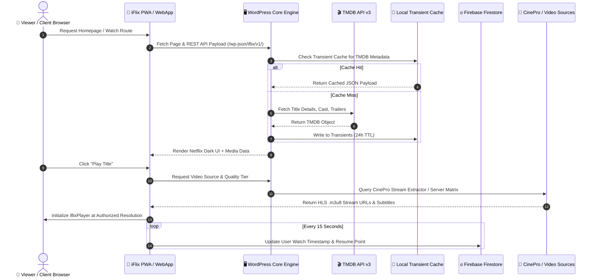

# iFlix Stream — Enterprise Video On-Demand & Streaming Platform for WordPress

<p align="center">
  
</p>

<p align="center">
  <a href="https://wordpress.org"></a>
  <a href="https://php.net"></a>
  <a href="https://firebase.google.com"></a>
  <a href="https://www.themoviedb.org/"></a>
  <a href="https://web.dev/progressive-web-apps/"></a>
  <a href="docs/LICENSE.md"></a>
</p>

<p align="center">
  <a href="https://iflix.stream">
    
  </a>
  <a href="docs/README.md">
    
  </a>
</p>

> **iFlix Stream** is a turnkey, high-performance **Video On-Demand (VOD) and OTT streaming platform** engineered specifically for WordPress. Combining an authentic, pixel-perfect 1:1 Netflix-inspired cinematic dark interface with enterprise cloud infrastructure, it features automated TMDB media synchronization, multi-server video streaming with CinePro HLS extraction, Firebase cross-device cloud synchronization, multi-profile user management with Kids PIN security, monetization paywalls, and offline-capable Progressive Web App (PWA) deployment.

---

## 📑 Complete Documentation Suite Index

| Category | Guide | Audience | Summary |
|---|---|---|---|
| **Setup & Config** | [**docs/setup/installation.md**](docs/setup/installation.md) | DevOps / Admins | Server prerequisites, theme & plugin installation, rewrite rules & permalinks. |
| **Setup & Config** | [**docs/setup/tmdb-configuration.md**](docs/setup/tmdb-configuration.md) | Administrators | TMDB v3 API authentication, transient caching tiers, and localized catalogs. |
| **Setup & Config** | [**docs/setup/firebase-configuration.md**](docs/setup/firebase-configuration.md) | Architects | Firebase Auth, Firestore indexes, security rules, and Web SDK credentials. |
| **Setup & Config** | [**docs/setup/troubleshooting-faq.md**](docs/setup/troubleshooting-faq.md) | Support / DevOps | Video player CORS, SSL handshake, cache flushing, and server diagnostics. |
| **Administration** | [**docs/admin/dashboard-and-health.md**](docs/admin/dashboard-and-health.md) | Administrators | System health metrics, TMDB latency checks, and transient cache purge. |
| **Administration** | [**docs/admin/video-sources-manager.md**](docs/admin/video-sources-manager.md) | Content Editors | Video Source CPT, multi-server failover priority, global vs ID overrides. |
| **Administration** | [**docs/admin/cinepro-integration.md**](docs/admin/cinepro-integration.md) | Streaming Engineers | CinePro API integration, zero-ad direct HLS/MP4 extraction, and VIP quality gating. |
| **Administration** | [**docs/admin/section-builder.md**](docs/admin/section-builder.md) | Content Curators | Visual homepage carousel manager, automated TMDB feeds, and custom rows. |
| **Administration** | [**docs/admin/endpoint-presets.md**](docs/admin/endpoint-presets.md) | Developers | Custom TMDB Discover query builders, genre filters, and sort configurations. |
| **Administration** | [**docs/admin/notifications-manager.md**](docs/admin/notifications-manager.md) | Marketing / Admins | Push notifications, automated title seeders, and subscriber broadcast system. |
| **Administration** | [**docs/admin/subscription-and-paywall.md**](docs/admin/subscription-and-paywall.md) | Monetization Teams | Paywall rules, membership tiers (Basic/Standard/Premium), and quality limits. |
| **Administration** | [**docs/admin/security-and-licensing.md**](docs/admin/security-and-licensing.md) | Security Officers | Iframe sandboxing, anti-devtools, domain locking, and client encryption. |
| **User Experience** | [**docs/user/player-and-streaming.md**](docs/user/player-and-streaming.md) | End-Users / Viewers | iflixPlayer hotkeys, audio & subtitle selection, skip intro, and auto-next episode. |
| **User Experience** | [**docs/user/account-and-profiles.md**](docs/user/account-and-profiles.md) | End-Users / Viewers | Profile avatars, Kids profile mode, 4-digit security PIN, and account settings. |
| **User Experience** | [**docs/user/my-list-and-history.md**](docs/user/my-list-and-history.md) | End-Users / Viewers | Watchlist persistence, real-time resume points, and profile-isolated likes. |
| **User Experience** | [**docs/user/pwa-mobile-experience.md**](docs/user/pwa-mobile-experience.md) | Mobile Users | Desktop/Mobile PWA installation, offline capabilities, and touch gestures. |
| **Developer Hub** | [**docs/developer/rest-api-reference.md**](docs/developer/rest-api-reference.md) | Developers | `/wp-json/iflix/v1/` endpoints, payload structures, and response schemas. |
| **Developer Hub** | [**docs/developer/hooks-and-filters.md**](docs/developer/hooks-and-filters.md) | Developers | Core PHP actions, WordPress filters, and frontend JavaScript events. |
| **Developer Hub** | [**docs/developer/database-and-schema.md**](docs/developer/database-and-schema.md) | Database Engs | WordPress options table, user meta keys, and Firestore schema layout. |

---

## ⚡ Key Highlights & Core Capabilities



### 1. 1:1 Cinematic Netflix-Grade Streaming UI
- **Billboard Hero Slider**: Dynamic featured banners with autoplaying mute-toggled trailers, age ratings, genres, and dual CTA buttons.
- **Micro-Interaction Hover Previews**: Desktop cards expand smoothly on hover with video trailer preview, sound toggle, quality badges, and instant modal trigger.
- **Quick Detail & Episode Modals**: Slide-over bottom drawer on mobile and centered viewport modal on desktop displaying full cast, seasons dropdown, and episodes grid.

### 2. Multi-Profile Cloud Engine with Kids PIN Protection
- **Profile Partitioning**: Up to 6 profiles per account (matching Netflix standard: 5 adult/general profiles + 1 Kids profile).
- **Profile-Level Isolation**: Watch history, resume timestamps, favorites, and "My List" stored independently per profile.
- **Kids Mode Security**: Dedicated Kids interface with strictly filtered G/PG ratings and parental 4-digit PIN lock required to switch back to adult profiles.

### 3. CinePro Native Direct Streaming & Multi-Server Failover
- **Direct Video Streams**: Replaces ad-riddled iframe embeds with pure HLS (`.m3u8`) and MP4 video streams via the CinePro Core API integration.
- **Automated Fallback Cascade**: If the primary direct stream is unavailable, the player seamlessly cascades down to configured fallback mirrors (VidLink, AutoEmbed, VidSrc, MultiEmbed) without viewer interruption.
- **Subscription Quality Gating**: Dynamically enforces resolution limits based on user plan (Free: 360p, Basic: 720p, Standard: 1080p, Premium: 4K Ultra HD + HDR).

### 4. Firebase Cloud Database & Real-Time Sync
- **No Heavy Server Load**: Offloads high-frequency watch-progress updates, likes, and watchlists to Google Firebase Firestore.
- **Instant Cross-Device Resume**: Start watching a movie on your smartphone PWA and resume at the exact second on your desktop browser.
- **Guest-State Fallback**: Gracefully operates using browser `localStorage` for unregistered visitors and seamlessly merges saved titles into Firestore upon registration.

### 5. Automated Content Engine via TMDB API v3
- **Zero Manual Data Entry**: Enter any TMDB Movie or TV ID to instantly populate synopsis, high-res backdrops, official posters, release years, genre chips, and cast photos.
- **Intelligent Two-Tier Caching**: WordPress transients store API responses for 24 hours, reducing external network latency to `<10ms` for cached requests.
- **Section Builder & Endpoint Presets**: Create custom homepage rows (`Trending Anime`, `K-Drama Sensations`, `Top 10 Today`, `Award Winners`) in seconds using visual query builders.

---

## 🏛️ System Architecture



---

## 🛠️ Technology Stack & Requirements

### Infrastructure Requirements
| Component | Minimum Version | Recommended | Purpose |
|---|---|---|---|
| **Web Server** | Nginx 1.20+ / Apache 2.4+ | Nginx 1.24+ with HTTP/2 & Gzip | Fast static asset delivery |
| **PHP Engine** | PHP 8.1 | PHP 8.2+ with OPcache | Strict types & async curl |
| **Database** | MySQL 5.7+ / MariaDB 10.4+ | MariaDB 10.6+ | WordPress core data |
| **WordPress** | 6.0 | 6.4+ | Base CMS platform |
| **HTTPS / SSL** | TLS 1.2 | TLS 1.3 | Required for PWA & Service Workers |
| **PHP Extensions** | `curl`, `json`, `mbstring`, `openssl` | `gd` or `imagick`, `zlib` | API communication & image handling |

### Client-Side Stack
- **JavaScript**: ES6+ Vanilla JavaScript architecture (Zero bulky jQuery dependencies in player or dashboard).
- **Video Playback**: Native HTML5 Video + `HLS.js` engine with custom WebVTT subtitle parser.
- **Cloud Backend**: Google Firebase Auth v9 (Compat) & Google Cloud Firestore.
- **Mobile Packaging**: Progressive Web App (PWA) with Cache-First Service Worker and Web App Manifest.

---

## 🚀 Quick Start Guide (5-Minute Deployment)

### 1. Download & Prepare Repository
Clone the repository into your WordPress development environment:

```bash
cd wp-content/themes/
git clone https://github.com/yourusername/iflix-stream.git iflix
cd ../plugins/
git clone https://github.com/yourusername/iflix-stream-core.git iflix-core
```

### 2. Activate Theme and Core Engine
1. Navigate to your **WordPress Admin Panel** -> **Appearance** -> **Themes**.
2. Activate **iFlix Stream**.
3. Navigate to **Plugins** -> **Installed Plugins**.
4. Activate **iFlix Stream Core**.

### 3. Connect TMDB API
1. Register for a free API Key at [The Movie Database (TMDB)](https://www.themoviedb.org/settings/api).
2. Go to **iFlix Stream** -> **Settings** -> **TMDB API** in your WordPress admin dashboard.
3. Paste your **TMDB API Key (v3 auth)** and click **Test Connection & Save**.

### 4. Connect Firebase Auth & Firestore
1. Create a project in the [Firebase Console](https://console.firebase.google.com/).
2. Enable **Authentication** (Email/Password and Google sign-in).
3. Enable **Cloud Firestore** in Production mode.
4. Go to **Project Settings** -> **General** -> **Your apps** -> **Web app**, and copy the configuration snippet.
5. In your WordPress admin, navigate to **iFlix Stream** -> **Settings** -> **Firebase** and enter your credentials.
6. Deploy the Firestore security rules from [docs/setup/firebase-configuration.md](docs/setup/firebase-configuration.md).

### 5. Verify Video Source Matrix
1. Go to **iFlix Stream** -> **Video Sources**.
2. If the table is empty, click **Seed Default Global Sources** to immediately configure default streaming mirrors for movies and TV shows.

---

## 🔒 Security & Best Practices

- **Strict Iframe Sandboxing**: Embedded sources run with strict `sandbox="allow-scripts allow-same-origin allow-forms allow-presentation allow-downloads"` to block malicious top-level redirects and popups.
- **REST Nonce Verification**: Every frontend AJAX call and REST API request validates a dynamic WordPress Nonce (`X-WP-Nonce`).
- **Parental Controls & Data Isolation**: Kids profile PIN hashing and profile IDs are validated server-side and within Firestore security rules.
- **Anti-DevTools Protection**: Built-in optional script debugger detection and right-click protection to safeguard copyrighted material.

---

## 👥 Contributors & Community

Developed and maintained by **Ayeng** ([Ayeng Coding](https://www.ayengcoding.com/)).

- 🌐 **Official Website**: [https://iflix.stream](https://iflix.stream)
- 💬 **Telegram Support**: [@ayengcoding](https://t.me/ayengcoding)
- 🐛 **Issue Tracker**: [GitHub Issues](https://github.com/yourusername/iflix-stream/issues)
- 📜 **Software License**: [GNU General Public License v2 or later](docs/LICENSE.md)
