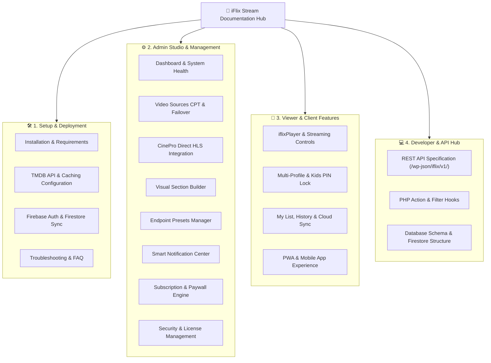

# iFlix Stream Documentation Portal

Welcome to the official developer and administrative documentation hub for **iFlix Stream**. This comprehensive portal provides end-to-end guidance for deploying, customizing, monetizing, and managing an enterprise-scale video streaming platform on WordPress.

---

## 🧭 Documentation Map

---

## 📚 Section Breakdown

### [1. Setup & Configuration](setup/README.md)
Everything required to bring an iFlix Stream site from zero to fully operational in under 15 minutes.
- **[Installation Guide](setup/installation.md)**: Web server prerequisites, theme & plugin activation, Apache/Nginx rewrite rules.
- **[TMDB Configuration](setup/tmdb-configuration.md)**: Generating v3 API keys, setting up 24-hour transients, language localization.
- **[Firebase Setup](setup/firebase-configuration.md)**: Project creation, Web SDK keys, Firestore collections, and security rules.
- **[Troubleshooting & FAQ](setup/troubleshooting-faq.md)**: Solutions for CORS warnings, player timeouts, cache invalidation, and common setup errors.

---

### [2. Admin Studio & Platform Operations](admin/README.md)
The WordPress administrative command center for streaming sources, homepage layouts, and monetization.
- **[Dashboard & Health](admin/dashboard-and-health.md)**: Live metrics, TMDB ping latency, and 1-click cache purge.
- **[Video Sources Manager](admin/video-sources-manager.md)**: Configuring multi-server failover pools and global vs per-title overrides.
- **[CinePro Integration](admin/cinepro-integration.md)**: Native API connection to self-hosted CinePro extractors for direct `.m3u8` streams.
- **[Section Builder](admin/section-builder.md)**: Drag-and-drop homepage rows, automated TMDB carousel endpoints, and manual rows.
- **[Endpoint Presets](admin/endpoint-presets.md)**: Visual query generator for custom genre feeds, trending series, and regional filters.
- **[Notifications Manager](admin/notifications-manager.md)**: Broadcast announcements, automated new-release alerts, and smart seeders.
- **[Subscription & Paywalls](admin/subscription-and-paywall.md)**: Defining pricing plans, quality resolution gating, and checkout flows.
- **[Security & Licensing](admin/security-and-licensing.md)**: Iframe sandbox protection, client anti-inspection, and domain locks.

---

### [3. Viewer & Client User Experience](user/README.md)
In-depth breakdown of consumer-facing features and mobile applications.
- **[iflixPlayer & Streaming](user/player-and-streaming.md)**: Keyboard hotkeys, audio tracks, WebVTT subtitle styling, auto-next, skip intro.
- **[Account & Multi-Profiles](user/account-and-profiles.md)**: Creating profiles, selecting avatars, Kids mode with 4-digit PIN lock.
- **[My List, History & Cloud Sync](user/my-list-and-history.md)**: Cross-device bookmarks, continuous resume timestamps, and favorites.
- **[PWA & Mobile Experience](user/pwa-mobile-experience.md)**: Installing as a standalone app on iOS/Android, service workers, touch swipes.

---

### [4. Developer & Architecture Hub](developer/README.md)
Technical specifications for engineers extending or integrating with iFlix Stream.
- **[REST API Reference](developer/rest-api-reference.md)**: Complete OpenAPI-compliant docs for `/wp-json/iflix/v1/`.
- **[Hooks & Filters](developer/hooks-and-filters.md)**: Action and filter reference for customizing backend logic and frontend markup.
- **[Database & Schema](developer/database-and-schema.md)**: Options keys, user meta tables, post meta, and Firestore collections tree.
