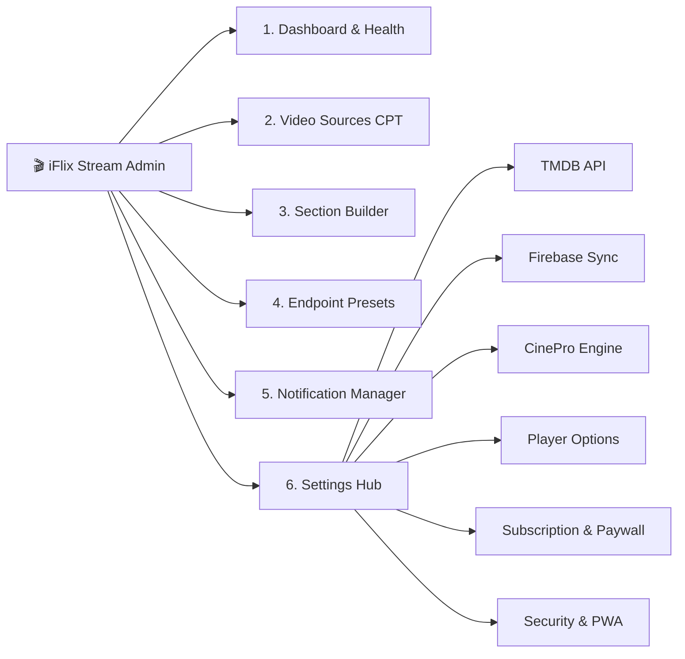

# Admin Studio & Operations Guide

The **iFlix Stream Admin Studio** is a unified command center built directly inside the WordPress administrative interface (`wp-admin`). It equips streaming operators, content curators, and system administrators with powerful tools to manage video pipelines, curate homepage rows, monitor server health, and drive monetization.

---

## 🎛️ Admin Studio Navigation Structure

---

## 📑 Administrative Guides in this Section

| Module | Document | Description |
|---|---|---|
| **System Overview** | [**dashboard-and-health.md**](dashboard-and-health.md) | Real-time health metrics, TMDB ping latency, transient cache purge. |
| **Video Infrastructure** | [**video-sources-manager.md**](video-sources-manager.md) | Multi-server failover pools, global fallbacks, and TMDB ID overrides. |
| **Direct HLS Engine** | [**cinepro-integration.md**](cinepro-integration.md) | Connecting self-hosted CinePro extractors for direct `.m3u8` streams. |
| **Content Curation** | [**section-builder.md**](section-builder.md) | Visual homepage row creator, carousel order, and TMDB dynamic feeds. |
| **Catalog Presets** | [**endpoint-presets.md**](endpoint-presets.md) | Custom TMDB Discover query builder for niche genres, anime, and dramas. |
| **Audience Engagement** | [**notifications-manager.md**](notifications-manager.md) | In-app notification center, automated title alerts, and broadcast messages. |
| **Monetization Engine** | [**subscription-and-paywall.md**](subscription-and-paywall.md) | Paywall gating rules, subscription tiers, pricing, and video resolution caps. |
| **Platform Hardening** | [**security-and-licensing.md**](security-and-licensing.md) | Iframe sandboxing, anti-devtools, domain locks, and license management. |
