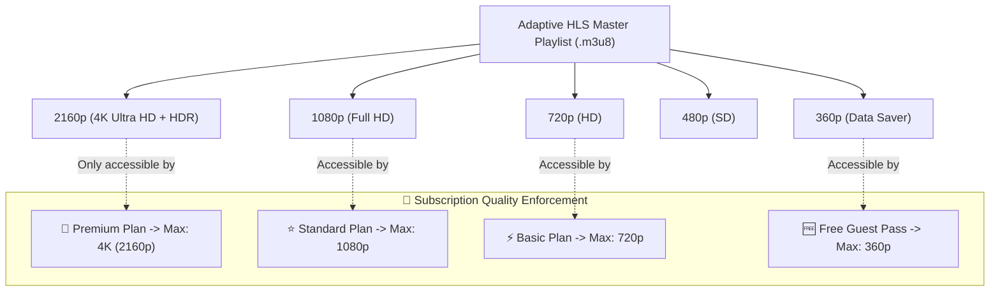

# CinePro Native Direct Streaming Integration

The **CinePro Integration** enables iFlix Stream to communicate with a dedicated or self-hosted **CinePro Core** instance. By converting external embed sources into direct, pure HLS (`.m3u8`) and MP4 video streams, it eliminates invasive third-party banner ads, prevents pop-under malware, and empowers the native **iflixPlayer** with complete playback control, custom subtitle styling, and resolution tier gating.

---

## 🌟 Why CinePro Direct Streams?

| Feature | Third-Party Iframe Embeds | CinePro Native Streams |
|---|---|---|
| **Viewer Ads & Popups** | Aggressive pop-unders, external banners | **100% Zero Ads / Clean Playback** |
| **Player Controls** | Locked to external player skins | **Custom Netflix-style iflixPlayer** |
| **Resolution Capping** | Controlled by external source | **Strictly gated by user subscription tier** |
| **Subtitle Customization** | Hardcoded or limited | **Custom WebVTT size, font, and background** |
| **PWA Picture-in-Picture** | Frequently blocked | **Full native PiP & background audio** |

---

## ⚙️ 1. Enabling CinePro in WordPress

1. In your WordPress dashboard, navigate to **iFlix Stream** -> **Settings**.
2. Click on the **CinePro Integration** tab.
3. Configure the connection parameters:

| Field | Description | Example / Default |
|---|---|---|
| **Enable CinePro Integration** | Master toggle to enable direct stream resolution. | `Enabled` |
| **CinePro API Base URL** | The endpoint of your CinePro instance (without trailing slash). | `https://api.cinepro.stream` |
| **CinePro Master API Key** | Secret bearer key required for server-to-server extraction requests. | `cp_sec_9f8b2c1e7a6d5c4b3a2` |
| **Stream Extraction Cache TTL**| Time in seconds to cache extracted `.m3u8` tokens. | `14400` (4 Hours) |

4. Click **Test CinePro Connection**.
   - If successful, you will see: `✅ CinePro API Bridge Active (Latency: 82ms)`.
5. Click **Save Changes**.

---

## 👑 2. Subscription Resolution Tier Matrix

When CinePro delivers an adaptive multi-bitrate HLS stream, iFlix Stream automatically enforces the maximum resolution permitted by the viewer's active subscription tier:



### Quality Level Definition in Code
Configured via `IFLIX\Core\Video_Sources\CinePro`:
```php
const QUALITY_MAP = array(
    '360p'  => 360,
    '480p'  => 480,
    '720p'  => 720,
    '1080p' => 1080,
    '4k'    => 2160,
);

const TIER_MAX_QUALITY = array(
    'free'     => 360,
    'basic'    => 720,
    'standard' => 1080,
    'premium'  => 2160,
);
```

---

## 🔄 3. Automated Stream Failover

If the CinePro instance cannot extract a direct playable stream for a specific obscure or older title, the core player engine automatically and silently falls back to the configured secondary **Video Sources CPT** iframe mirror. Your viewers will never see a blank player or an error screen.
