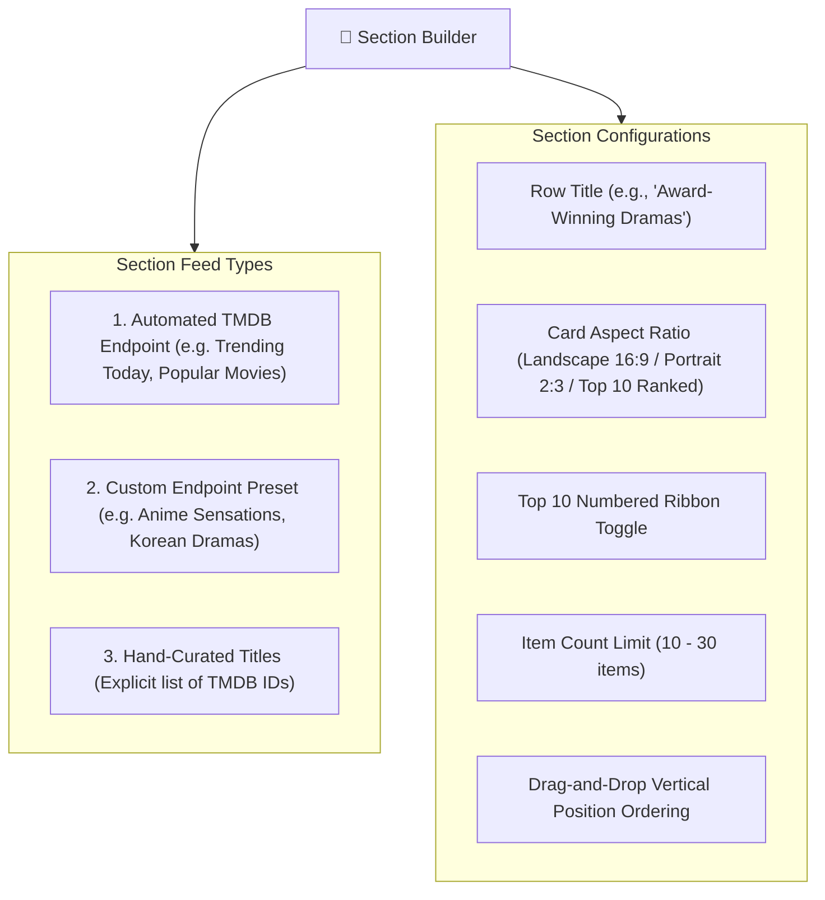

# Section Builder (Homepage Carousel Manager)

The **Section Builder** gives administrators complete visual control over the layout, ordering, and content feeds of the iFlix Stream homepage. Located in `wp-admin` under **iFlix Stream** -> **Section Builder**, it allows you to build, reorder, and configure dynamic or curated Netflix-style horizontal carousels without touching a single line of template code.

---

## 🎨 Interface & Capabilities

---

## 🛠️ Step-by-Step: Adding a New Carousel Row

1. In `wp-admin`, click **iFlix Stream** -> **Section Builder**.
2. Click the **+ Add New Section** button.
3. Configure the row properties:
   - **Section Title**: Enter a compelling, category-defining title (e.g., `Binge-Worthy K-Dramas`, `Top 10 Movies Today`, `Sci-Fi & Cyberpunk`).
   - **Data Source**:
     - `Trending Movies`: Ingests TMDB `/trending/movie/day`.
     - `Trending TV Series`: Ingests TMDB `/trending/tv/day`.
     - `Top Rated`: Ingests TMDB `/movie/top_rated`.
     - `Custom Preset`: Select any custom preset saved in the **Endpoint Presets** manager.
     - `Manual IDs`: Enter a comma-separated list of specific TMDB IDs (e.g., `550, 157336, 27205`).
   - **Card Layout**:
     - `Poster (Portrait 2:3)`: Standard cinematic movie posters.
     - `Backdrop (Landscape 16:9)`: Wide cinematic stills (ideal for trending rows with overview text).
     - `Top 10 (Ranked)`: Displays large, stylized Netflix numbers (`#1` through `#10`) beside each poster.
   - **Item Count**: Choose the maximum number of titles to fetch (default: `20`).
4. **Reorder**: Click and hold the drag handle (`☰`) to reorder the section relative to other rows on the homepage.
5. Click **Save Sections Layout**.

---

## ⚡ Resetting to Netflix Factory Defaults

If you ever need to restore the platform's original, balanced row configuration:
1. Click **Reset to Default Sections**.
2. Confirm the action. iFlix Stream will reload the canonical Netflix layout:
   - *Trending Today (Billboard)*
   - *Top 10 Movies in the United States Today*
   - *Popular on iFlix*
   - *New Releases & Coming This Week*
   - *Critically Acclaimed TV Dramas*
   - *Anime & Animation Spotlight*
