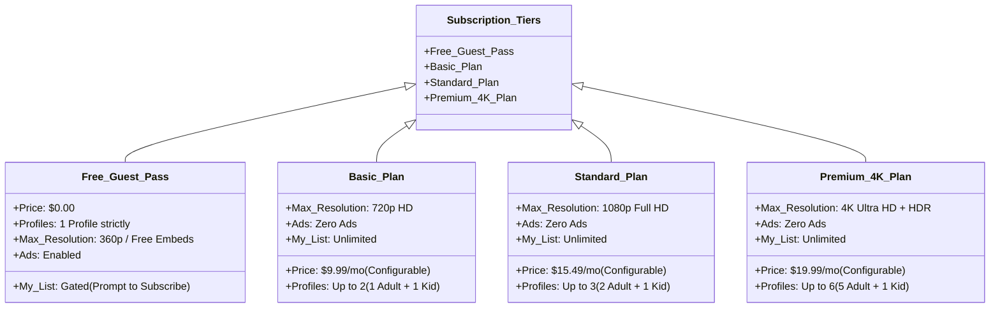

# Subscription & Monetization Paywall

**iFlix Stream** features a native, flexible **Monetization & Paywall Engine**. Built into both the WordPress administrative settings and frontend client scripts, it allows site operators to gate full video playback, enforce maximum resolution caps, limit multi-profile slots, and gate personalization features behind active membership tiers.

---

## 💰 Subscription Tier Architecture

---

## ⚙️ 1. Configuring Monetization Rules

Navigate to **iFlix Stream** -> **Settings** -> **Subscription** in `wp-admin`:

| Setting | Type | Description |
|---|---|---|
| **Enable Paywall** | Checkbox | Master paywall toggle. When checked, users must hold an active subscription to access full playback and bookmarking. |
| **Currency Symbol** | Text | Currency identifier displayed to viewers (e.g., `$`, `€`, `£`, `₱`). |
| **Basic Plan Price** | Number | Monthly recurring price for Basic plan (default: `9.99`). |
| **Standard Plan Price** | Number | Monthly recurring price for Standard plan (default: `15.49`). |
| **Premium Plan Price** | Number | Monthly recurring price for Premium plan (default: `19.99`). |
| **Payment Mode** | Dropdown | `free_instant` (Instant activation for demos/trials) or `gateway_integrated` (Checkout integration). |

---

## 🔒 2. Paywall Gating Enforcement Points

The paywall is enforced at three distinct touchpoints across the user journey:

### 1. In-Player Watch Overlay (`page-watch.php`)
If an unsubscribed user directly visits a watch URL (e.g., `/watch/550/`), the HTML5 player is locked, and a modal card appears with a padlock icon:
> **Subscription Required to Stream**  
> *"Watch Fight Club in Full HD / 4K Ultra HD. Choose a plan to unlock unlimited streaming with zero ads."*  
> `[ View Plans & Pricing ]` -> Redirects to `/subscription/`.

### 2. Action Interceptors on Homepage & Sliders (`app.js`)
When an unsubscribed user clicks:
- **Play Now** (`.btn-play`, `.btn-hero-play`)
- **Add to My List** (`.btn-add-list`, `.btn-action-list`)
- **Like / Rate** (`.btn-like`)

A custom Netflix-styled modal appears prompting them to subscribe with a one-click CTA to view pricing plans.

### 3. Profile Creation Limits
In **Profile Management** (`page-profile.php`), attempting to add additional profiles beyond your plan quota prompts an upgrade dialog:
- Free: 1 Profile Max
- Basic: 2 Profiles Max
- Standard: 3 Profiles Max
- Premium: 6 Profiles Max

---

## 💳 3. Payment Gateway Integration

iFlix Stream supports seamless integration with payment processors (Stripe, Lemon Squeezy, PayPal, WooCommerce):
- The frontend checkout triggers `saveSubscription(plan)` in `app.js` upon verified webhook completion.
- Subscription status, expiration dates, and tier identifiers are persisted in both browser cookies (`iflix_sub_tier`) and Firestore user documents (`users/{uid}/subscription`).
