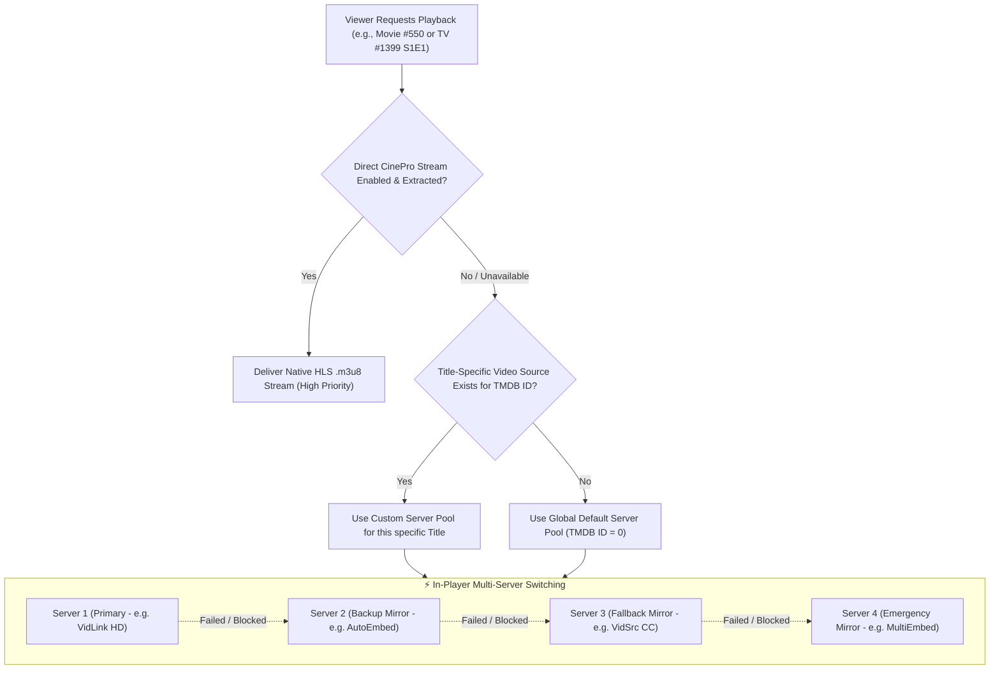

# Video Sources Manager & Multi-Server Failover

The **Video Sources Manager** is a cornerstone of iFlix Stream's streaming resilience. Powered by a specialized WordPress Custom Post Type (`iflix_video_source`), it enables administrators to configure resilient multi-server streaming pools, manage iframe versus direct HLS/MP4 delivery, and define global versus title-specific server rules.

---

## 🏛️ Video Source Hierarchy & Failover Logic

When a viewer presses **Play**, iFlix Stream evaluates streaming sources using a prioritized fallback cascade:

---

## 🛠️ Configuring Video Sources

Navigate to **iFlix Stream** -> **Video Sources** in `wp-admin`.

### Global Defaults vs TMDB Overrides
1. **Global Default (All Titles)**:
   - When **TMDB ID** is set to `0` (or left empty), this source applies globally to all movies or TV shows on your platform.
   - You should maintain at least one Global Movie Source and one Global TV Source.
2. **Title-Specific Override**:
   - If a specific blockbuster or licensed release has dedicated direct CDN URLs (e.g., Cloudflare R2, AWS S3, or a custom HLS stream), create a source and enter its exact **TMDB ID** (e.g., `550` for Fight Club, `1399` for Game of Thrones).
   - This title will automatically use its dedicated high-speed server rather than the global pool.

---

## 🎛️ Server Definition Meta Fields

When editing or adding a Video Source:

| Field | Type | Description & Placeholders |
|---|---|---|
| **Content Type** | Dropdown | `Movie` or `TV Show / Series`. |
| **TMDB ID Scope** | Number | `0` for Global Default, or a specific TMDB ID. |
| **Season & Episode** | Number | (TV only) Scope server to a specific episode, or leave as `0` for all episodes. |
| **Status Toggle** | Toggle | `Active` (Live in player) or `Disabled`. |
| **Server Name** | Text | Display label in the player server selector (e.g., `Server 1 (Ultra HD)`). |
| **Stream / Embed URL** | URL Pattern | The streaming or embed URL with dynamic placeholders. |
| **Stream Type** | Radio | `iframe Embed` or `Direct HLS / MP4 Stream`. |
| **Default Quality** | Badge | `1080p`, `720p`, `4K`, or `Auto`. |

### URL Dynamic Placeholders
The player engine automatically replaces the following template tags in real time:
- `{id}`: Replaced with the TMDB ID (e.g., `550`).
- `{season}`: Replaced with the current season number (e.g., `1`).
- `{episode}`: Replaced with the current episode number (e.g., `4`).
- `{imdb}`: Replaced with the IMDb ID if available (e.g., `tt0137523`).

**Example URL Patterns**:
- Movie Iframe: `https://vidlink.pro/movie/{id}`
- TV Show Iframe: `https://vidlink.pro/tv/{id}/{season}/{episode}`
- Direct Custom HLS: `https://cdn.yourdomain.com/hls/movies/{id}/master.m3u8`

---

## ⚡ 1-Click Default Sources Seeder

If starting fresh or after a reset:
1. Navigate to **iFlix Stream** -> **Video Sources**.
2. Click **Seed Default Sources**.
3. iFlix Stream will immediately generate optimized multi-server configurations for both Movies and TV Series with pre-tested fallback mirrors.
