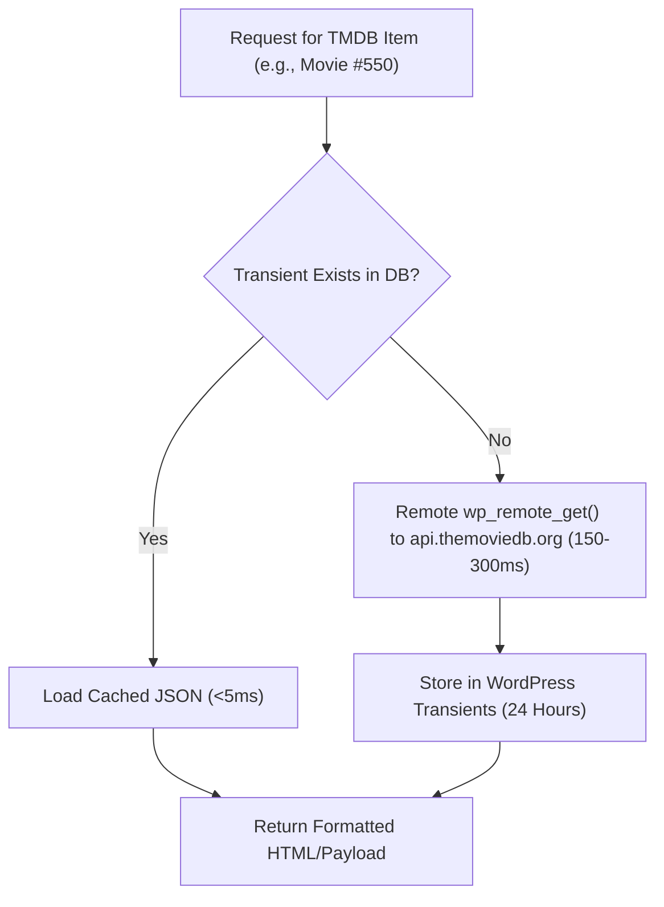

# The Movie Database (TMDB) API & Caching Configuration

**iFlix Stream** leverages **The Movie Database (TMDB) API v3** to automate 100% of your platform's movie and TV show catalog metadata. With a valid API key connected, the theme automatically ingests titles, high-resolution backdrops, localized posters, cast profiles, trailers, genres, and release dates in real time.

---

## 🔑 1. Obtaining a Free TMDB API v3 Key

1. Visit [The Movie Database (TMDB)](https://www.themoviedb.org/) and register for an account (or log in).
2. Go to your **Account Settings** -> **API** ([themoviedb.org/settings/api](https://www.themoviedb.org/settings/api)).
3. Under **Request an API Key**, click **Create** and select **Developer**.
4. Fill in your website application details:
   - **Application Name**: `iFlix Stream Portal`
   - **Application URL**: `https://yourdomain.com`
   - **Application Summary**: `Personalized video streaming portal and catalog viewer powered by TMDB metadata.`
5. Once submitted, your **API Key (v3 auth)** (a 32-character hexadecimal string) will be generated immediately.

---

## ⚙️ 2. Connecting TMDB to WordPress

1. In your WordPress admin dashboard, navigate to **iFlix Stream** -> **Settings**.
2. Click on the **TMDB API** tab.
3. Configure the following fields:

| Field | Description | Example / Recommended |
|---|---|---|
| **TMDB API Key (v3)** | Your 32-character developer key from TMDB. | `4f8b2c1e9a0d3f7e6b5a4c3d2e1f0a9b` |
| **Default Language** | The ISO 639-1 language code for titles and overviews. | `en-US` (or `es-ES`, `fr-FR`, `ja-JP`, `ko-KR`) |
| **Include Adult Content** | Toggle to filter out explicit adult 18+ titles from discovery queries. | `Off` (Recommended for general audiences) |
| **Cache Duration** | Time in hours to cache API responses in WordPress transients. | `24` (Recommended: 24 Hours) |
| **Image Resolution Base** | CDN endpoint for TMDB image rendering. | `https://image.tmdb.org/t/p/` |

4. Click **Test TMDB Connection**.
   - If successful, you will see a green badge: `✅ TMDB API Connected Successfully (HTTP 200)`.
5. Click **Save Changes**.

---

## ⚡ 3. Intelligent Two-Tier Transient Caching

To guarantee sub-second page loads and stay well within TMDB rate limits, iFlix Stream uses WordPress transients:

### Cache Invalidation & Flushing
- **Automatic Expiry**: Transients expire automatically after the configured duration (default: 86,400 seconds / 24 hours).
- **Manual 1-Click Flush**: Go to **iFlix Stream** -> **Dashboard & Health**, and click **Flush TMDB Cache**. This clears all transient records prefixed with `_transient_iflix_` without affecting any user accounts or settings.

---

## 🌍 4. Multi-Language & Regional Content Feeds

To localize content for specific countries:
1. In **TMDB Settings**, change **Default Language** (e.g., `es-MX` for Spanish Latin America, `ja-JP` for Japanese).
2. In **iFlix Stream** -> **Endpoint Presets**, configure regional discovery queries:
   - For Korean Dramas: `with_original_language=ko&sort_by=popularity.desc`
   - For Anime: `with_genres=16&with_original_language=ja&sort_by=popularity.desc`
   - For Bollywood: `with_origin_country=IN&sort_by=popularity.desc`
