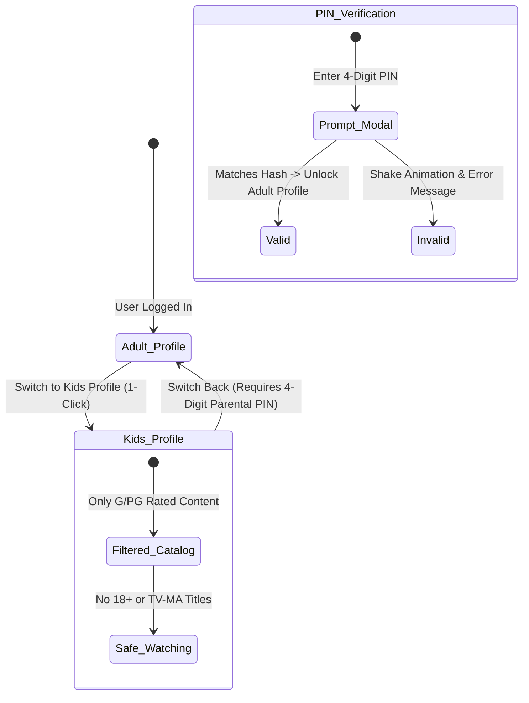

# Multi-Profile System & Parental PIN Controls

**iFlix Stream** provides a complete multi-profile architecture modeled directly after Netflix. Multiple household members can share a single account while enjoying completely separated watchlists, individual recommendations, and distinct viewing histories.

---

## 👥 Profile Management

Accessible via the header profile avatar dropdown -> **Manage Profiles** (or `/profile/`).

### 1. Creating & Editing Profiles
- **Profile Name**: Customize display name (e.g., *Alex, Sarah, Kids*).
- **Avatar Selection**: Choose from 8 high-resolution themed SVG avatars.
- **Profile Quotas**:
  - **Free Guest**: 1 Profile
  - **Basic Plan**: Up to 2 Profiles (1 Adult + 1 Kid)
  - **Standard Plan**: Up to 3 Profiles (2 Adult + 1 Kid)
  - **Premium 4K Plan**: Up to 6 Profiles (5 Adult + 1 Kid)

---

## 🧒 Kids Mode with Parental PIN Security

### How Kids Mode Protects Younger Viewers:
1. **Catalog Censorship**: Automatically hides all titles rated `18+`, `TV-MA`, `R`, or with mature TMDB genre tags (`Horror`, `Crime`, `Erotica`).
2. **Simplified Navigation**: The UI simplifies carousels into colorful character-driven rows (Cartoons, Animated Adventures, Family Movies).
3. **Parental PIN Lock**: When a child tries to switch back to an adult profile, the system prompts for a **4-digit numerical PIN**. The profile remains locked until the parent enters the correct code.
