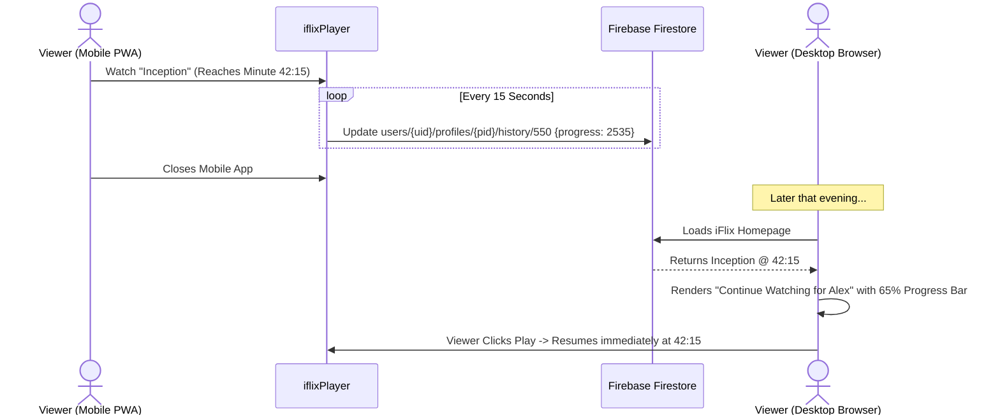

# My List, Watch History & Cloud Sync

**iFlix Stream** provides uninterrupted viewing continuity across smartphones, tablets, laptops, and smart TVs using real-time synchronization backed by Google Cloud Firestore.

---

## 📌 1. "My List" (Personal Watchlist)

Viewers can bookmark any movie or TV series to their personal queue:
- **Adding / Removing**: Click the **`+` (Add to My List)** button on the billboard slider, hover preview card, or details modal. The icon animates into a checkmark (`✓`) when active.
- **Dedicated Watchlist Page** (`/my-list/`): View your bookmarked titles organized into responsive grid cards with filters for `All`, `Movies`, and `TV Shows`.
- **Profile Partitioning**: Each profile maintains its own completely independent watchlist.

---

## ⏱️ 2. Watch History & "Continue Watching"

### Resume Accuracy
- Progress is automatically saved every 15 seconds during active playback and on player pause or tab close.
- When progress exceeds **92%** of the duration, the title is automatically marked as "Finished" and cleared from the *Continue Watching* carousel.

---

## 👍 3. Liking & Rating Titles

- Click the **Thumbs Up (I like this)** button on any title to save it to your favorites.
- Liked titles are highlighted with an emerald glow and factor into personalized recommendation algorithms.
