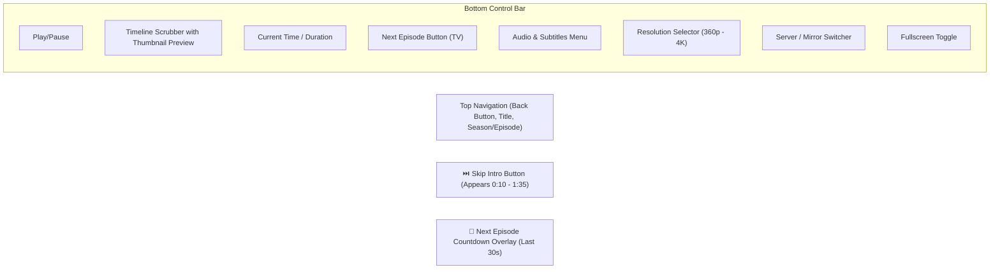

# iflixPlayer & Streaming Experience

The **iflixPlayer** is a custom, high-performance HTML5 and HLS video player module engineered specifically for iFlix Stream. It combines the sleek aesthetic of the Netflix video interface with modern video playback capabilities.

---

## ⌨️ Desktop Keyboard Shortcuts

Viewers can control playback using standard media hotkeys:

| Key | Action |
|---|---|
| **Spacebar** or **K** | Toggle Play / Pause |
| **F** | Toggle Fullscreen Mode |
| **M** | Toggle Mute / Unmute Audio |
| **Left Arrow (←)** | Seek Backward 10 Seconds |
| **Right Arrow (→)** | Seek Forward 10 Seconds |
| **Up Arrow (↑)** | Increase Volume by 10% |
| **Down Arrow (↓)** | Decrease Volume by 10% |
| **C** | Toggle Closed Captions / Subtitles |
| **S** | Skip Intro / Recap |
| **N** | Play Next Episode (TV Series) |
| **Escape** | Exit Fullscreen Mode / Close Modals |

---

## 🎛️ On-Screen Player Controls

---

## ⏭️ Smart Playback Features

### 1. Skip Intro Button
- When watching TV episodes, a **Skip Intro** pill button automatically animates into the bottom-right corner during opening theme sequences (configurable between 10 seconds and 90 seconds).
- Pressing **S** on your keyboard or clicking the button immediately advances the timeline past the intro credits.

### 2. Auto-Play Next Episode
- During the final 30 seconds of an episode, an interactive **Next Episode** countdown card appears in the bottom right corner with the upcoming episode title and thumbnail.
- If not canceled, playback transitions seamlessly into the next episode with zero buffering pause.

### 3. Multi-Track Subtitles & Audio
- Supports multiple localized WebVTT subtitle tracks.
- Viewers can customize subtitle font size, text color, and background opacity in the Subtitle Settings dialog.
