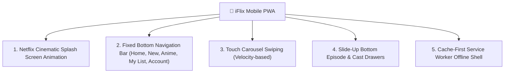

# Progressive Web App (PWA) & Mobile Experience

**iFlix Stream** is designed from the ground up as an installable **Progressive Web App (PWA)**. Mobile visitors receive a native application experience without needing to download large binary packages from the Apple App Store or Google Play Store.

---

## 📱 Mobile Architecture & UI Features

---

## 📲 How to Install iFlix as a Native App

### On Apple iOS (iPhone & iPad)
1. Open Safari and navigate to your iFlix Stream domain (`https://streaming.yourdomain.com`).
2. Tap the **Share** button (the square icon with an upward arrow) at the bottom of the screen.
3. Scroll down and tap **Add to Home Screen**.
4. Tap **Add** in the top-right corner.
5. The iFlix Stream icon will appear directly on your home screen and launches in full-screen standalone mode (without Safari URL bars or browser chrome).

### On Google Android (Chrome / Brave / Samsung Internet)
1. Open Google Chrome and visit your streaming site.
2. An automatic banner will prompt: **"Add iFlix to Home Screen"**.
3. Tap **Install**.
4. The app will be installed to your application drawer with native notification permissions.

### On Desktop (Chrome, Edge, macOS, Windows)
1. In the browser address bar, click the **Install App icon** (computer monitor with download arrow).
2. Click **Install**.
3. iFlix Stream opens as an independent desktop window with window controls and dock/taskbar pin capability.

---

## ⚡ Offline Caching Strategy

The included Service Worker (`service-worker.js`) utilizes a **Stale-While-Revalidate** caching strategy:
- Core application shell assets (HTML structure, `main.css`, `player.css`, `app.js`, SVGs) are cached in `CacheStorage`.
- If a viewer loses their internet connection, the app continues to display their watchlist and cached titles rather than displaying a browser error screen.
